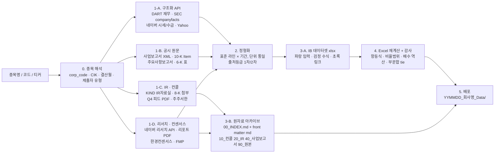

# 상장사 분석 데이터셋 파이프라인 - 기획과 파싱 방법론

국내(KRX)·해외(SEC 제출사) 상장사 한 종목을 **종목명 하나로 받아, 숫자 전용 IB 서식 데이터셋 1파일 + 읽기용 원자료 아카이브 1폴더**로 만드는 파이프라인의 기획·구현 기록입니다.

재무 API 하나로는 분석에 필요한 숫자의 절반밖에 못 채웁니다. 부문별 매출, 가이던스, 설비 capa, 오버행(락업·CB), 증권사 추정치 변동 같은 건 **공시 원문·IR 덱·컨퍼런스콜 전문·증권사 리서치 PDF** 안에만 있습니다. 그래서 이 파이프라인은 API와 문서 파싱을 **같은 코드 흐름 안에서** 돌리고, 결과를 같은 검산 규칙으로 묶습니다.

| 항목 | 내용 |
|---|---|
| 대상 | 국내 상장사(KOSPI·KOSDAQ), 미국 SEC 제출사(10-K/10-Q 및 20-F/6-K), 국내 비상장 외감법인(감사보고서 원문) |
| 입력 | 종목명 또는 종목코드 1개 (미국은 티커 또는 CIK) |
| 출력 | ① `YYMMDD_회사명_Data.xlsx` - 15~45개 시트, 숫자만, 파랑/검정/초록 색 규칙 ② `YYMMDD_회사명_공시IR/` - 공시·IR·컨콜·리서치를 UTF-8 md로 정형화한 아카이브 |
| 원천 | OpenDART API · DART 공시 원문(XML/HTML) · KIND IR자료실 · 네이버증권 JSON API(시세·수급·컨센서스·리서치) · 증권사 리포트 PDF · SEC EDGAR companyfacts/XBRL 인스턴스/8-K·6-K 첨부 · Q4 IR 피드(컨콜 전문·IR 덱) · Yahoo · FINRA · KOSIS |
| 언어·도구 | Python 3.12+ (requests, openpyxl, pdfplumber/pymupdf), Excel COM 재계산(pywin32), SQLite (대량 유니버스는 [dart-sql-portfolio](https://github.com/dhpark19955-code/dart-sql-portfolio)) |
| 적용 사례 | 국내 상장사(플랫폼·게임·IT서비스·소재·지주·보험·반도체 장비 등 다수 업종), 미국 상장사(크립토 거래소·바이오·AI 인프라·SaaS), 국내 비상장 외감법인. 2026년 9월~11월에 반복 실행하며 규칙·함정을 누적 |

> 이 저장소는 **방법론 문서**입니다. 코드는 핵심 로직을 보여주는 발췌본이고, 실제 수집 결과(재무 수치·IR 수치·리포트 PDF)는 저작권·업무상 이유로 싣지 않습니다. 재현에 필요한 API 엔드포인트·규칙·함정은 전부 적었습니다.

---

## 목차

1. [왜 이렇게 만드나 - 문제의식](#1-왜-이렇게-만드나---문제의식)
2. [전체 흐름](#2-전체-흐름)
3. [기획 단계 - 데이터셋을 설계하는 규칙](#3-기획-단계---데이터셋을-설계하는-규칙)
4. [국내 상장사 파이프라인 (DART + 네이버)](#4-국내-상장사-파이프라인-dart--네이버)
5. [해외 상장사 파이프라인 (SEC EDGAR + Yahoo)](#5-해외-상장사-파이프라인-sec-edgar--yahoo)
6. [API 너머 - 공시 원문·IR·컨콜·리서치 파싱](#6-api-너머---공시-원문ir컨콜리서치-파싱)
7. [검산과 감사](#7-검산과-감사)
8. [갱신과 정정 보존](#8-갱신과-정정-보존)
9. [반복해서 터진 함정 모음](#9-반복해서-터진-함정-모음)
10. [운영 원칙 (키·접근·저작권)](#10-운영-원칙-키접근저작권)
11. [산출물 예시](#11-산출물-예시)

---

## 1. 왜 이렇게 만드나 - 문제의식

투자 검토용 숫자를 모을 때 실제로 겪은 문제 네 가지에서 출발했습니다.

**① API 숫자만으로는 질문에 답이 안 된다.** "이 회사 매출의 몇 %가 신사업인가", "다음 분기 가이던스는", "락업 해제 물량이 언제 얼마나 나오나", "증권사들이 지난 3개월간 추정치를 올렸나 내렸나"는 DART·SEC 재무 API 어디에도 없습니다. 사업보고서 본문 표, IR 덱, 컨콜 전문, 리서치 PDF를 읽어야 합니다.

**② 소스마다 같은 숫자가 다르다.** 네이버 시총은 장중가 또는 NXT(대체거래소) 혼입가, DART 분기 손익은 누적치, SEC 태그는 10-K와 10-Q가 다른 걸 쓰기도 하고, 증권사 리포트 표는 억원·십억원이 섞입니다. 같은 파일 안에서 정의를 통일하지 않으면 100배 오차가 그냥 들어옵니다.

**③ 숫자와 줄글이 섞이면 둘 다 못 쓴다.** 분석은 chat에서, 숫자는 Excel에서 봅니다. 그래서 **데이터셋 xlsx는 숫자만**, **아카이브 md는 원문만** 담고 서로 출처로 연결합니다.

**④ 한 번 고친 오류가 재발한다.** 데이터셋에서 정정한 값이 원천 파일에는 남아 있어, 최신본을 "소스에서 다시 빌드"하면 오류가 되살아납니다. 갱신은 감사를 통과한 사본 위에 얹습니다.

---

## 2. 전체 흐름



단계별로 **자동**과 **사람이 확정**을 나눕니다.

| 단계 | 자동 | 사람이 확정 |
|---|---|---|
| 수집 | API 호출, 원문 다운로드, PDF 텍스트 추출, 분류·저장 | 봇 차단·로그인벽 뒤 자료(우회하지 않음, 대체 출처 선택) |
| 정형화 | 표준 라인 매핑, 기간 합성, 단위 환산, 부호 규칙 | 라벨 별칭 추가(새 회사에서 매핑 0인 계정) |
| IR·컨콜 수치 | 숫자가 붙은 문장만 출처와 함께 추출 | 표에 넣을지, 어느 빈티지를 쓸지 |
| 검산 | 항등식·범위·역산 자동 검출 | 걸린 항목을 원문과 대조해 정정 또는 주석 |
| 보고 | 경고 목록, 회사별 미완 체크리스트 | "확인한 것 / 못 한 것 / 정정한 것" 작성 |

---

## 3. 기획 단계 - 데이터셋을 설계하는 규칙

### 3.1 세 층으로 나눈다

| 층 | 파일 | 용도 | 특징 |
|---|---|---|---|
| 전수 덤프본 | `MASTER_날짜.xlsx` | 대조·재현 | 원자료 전부, 100+ 시트여도 정리하지 않음 |
| 읽기용 편집본 | `MASTER_편집본_날짜.xlsx` | 사람이 훑기 | 표지 → 목차 → 섹션, 줄글 포함 |
| **IB 데이터셋** | `YYMMDD_회사명_Data.xlsx` | 분석·모델 입력 | **숫자만**, 색 규칙, README 시트에 뺀 것·빈티지 명시 |

최종 산출물은 세 번째입니다. 모델링(DCF·SOTP·민감도)과 줄글(연혁·논지·컨콜 요약)은 **넣지 않고** 뺀 목록을 README 시트에 적습니다. "없는 걸 있는 줄 알지 않게" 하는 것이 설계 목표입니다.

### 3.2 시트 번호 체계

번호가 곧 데이터 종류입니다. 회사가 달라도 같은 번호엔 같은 성격의 표가 들어갑니다.

```
00_README     데이터 사전(시트 하이퍼링크) · 색 규칙 · 제외한 것 · 빈티지·한계 · 출처등급
01_KPI        핵심지표 - 다른 시트 링크(초록)와 수식(검정)만. 성장률·마진·P×Q
10~13         IS/BS/CF  연결·별도 × 연간·분기  (API 원자료, 백만원, 파랑)
14            투자지표·컨센서스 (FnGuide 항목, E=추정)
15            재무비율 - 전부 10번대 참조 수식
16~2x         현금·투자자산 · 배당 · 주식총수 · 밸류에이션 배수 · Historical PER/PBR · 증권사 추정 변동
30~4x         부문·제품별 매출 · 비용 구조 · FCF/CAPEX · 순차입금 · 오버행(락업·CB·자기주식) · 산업지표
50~5x         지분구조 · 5%룰 보고 · 주주별 · 이사회 · 매집 이력
60~6x         업종 KPI 원자료 (KOSIS·협회 통계·해외 peer)
70~7x         수급 (기관·외국인 일별 순매수, 매입 평단)
9x            언론·2차 출처 기반 (1차와 분리, '미검증' 표기)
```

### 3.3 색과 서식 - 원자료와 가공을 눈으로 구분

| 색 | 의미 | 규칙 |
|---|---|---|
| 파랑 | 하드코딩 원자료 | API·원문에서 온 값. 손으로 고치면 주석 |
| 검정 | 같은 시트 수식 | 성장률·마진·합계 |
| 초록 | 다른 시트 링크 | KPI·비율 시트는 전부 초록+검정 |

음수는 괄호, 0은 `-`, 퍼센트는 분수로 저장, 배수는 `0.0x`. 병합 셀 대신 `centerContinuous`. A열 스페이서, B열 라벨, C열부터 데이터, 격자선 off. **각 시트 2행에 단위**를 쓰고 대표값 하나를 원자료와 대조합니다(소스 시트 제목의 단위가 값과 다른 경우가 실제로 있었습니다).

### 3.4 숫자에 붙이는 메타데이터

| 항목 | 왜 |
|---|---|
| 기준일·시세 시각(장중/종가) | 시총·배수가 달라짐. KRX 정규장 종가로 통일 |
| 단위·통화·결산월 | 20-F 회사는 결산월이 제각각, Yahoo는 주가·재무 통화가 섞임 |
| 출처등급 `1차(자사)` / `1차(DART·SEC)` / `2차(공개 전문·언론)` | 2차 수치는 1차와 대조 후에만 사용 |
| 0 ≠ None, "없음(확인)" ≠ "미수집" | 자기주식 API는 무활동을 `-` 더미 1행으로 줌. 0행을 명시적으로 남겨 구분 |
| 덱 빈티지 | IR 덱은 같은 과거치를 덱마다 다르게 재기재 - 빈티지별로 열을 나눔 |

---

## 4. 국내 상장사 파이프라인 (DART + 네이버)

### 4.1 원클릭 진입점

```
python run_pipeline.py <종목명|코드> [--skip-fetch] [--no-docs] [--date YYMMDD]
```

| 단계 | 하는 일 | 소요 |
|---|---|---|
| 0 종목 해석 | 종목명/코드 → 종목코드·corp_code·DART 정식명 (corpCode.xml 마스터) | 초 |
| 1 수집 | DART 재무제표(연결·별도, 6년·10분기) · 네이버 5년 시세/수급/재무요약 · DART 메타(주식총수·배당·최대주주·5%·임원) · CAPEX · 분기별 주식수 · (옵션) 공시 원문 XML | 5~10분 |
| 2 재무요약 | 표준 라인 매핑, **분기합 = 연간 검산** | 초 |
| 3 표준 데이터셋 | README·KPI·IS/BS/CF 4장·컨센·비율·배당·주식수·배수·FCF·순차입금·지분·5% | 초 |
| 4 파생 시트 | Historical PER/PBR(일별 종가 × TTM EPS/BPS), 수급 250D | 분 |
| 5 재계산·감사 | Excel COM 재계산 → 수식 오류 0 확인 → 감사 스크립트 | 2~3분 |
| 6 배포 | `Downloads\YYMMDD_회사명_Data\YYMMDD_회사명_Data.xlsx` | 초 |
| 7 체크리스트 | 자동화 안 되는 회사별 작업(부문매출·오버행·업종 KPI·IR)과 경고 출력 | - |

7단계가 핵심입니다. 파이프라인은 "다 됐다"고 하지 않고 **무엇이 안 됐는지**를 회사별로 찍어 줍니다. 예: "지배주주순이익 비었는데 비지배지분은 있음 → 라벨 별칭 누락", "차입금 0인데 부채비율 높음 → 차입금 별칭 누락".

### 4.2 원천별 수집 경로

| 데이터 | 소스 | 키 | 비고 |
|---|---|---|---|
| 재무제표(연결·별도, 연간·분기) | OpenDART `fnlttSinglAcntAll` | DART | 분기 IS는 `thstrm_amount`(3개월), 4Q = FY - 3Q누적, CF는 YTD 차분 |
| 주식총수·배당·최대주주·5%·임원 | OpenDART `stockTotqySttus` `alotMatter` `hyslrSttus` `majorstock` `elestock` | DART | 주식수 ×1000 오기 보정, 자기주식 무활동 더미행 처리 |
| 시세·시총·PER·PBR·거래상태 | 네이버 `m.stock.naver.com/api/stock/{code}/basic` `integration` | 없음 | 시총은 **상장주식수 × 종가**로 직접 계산, 네이버 marketValue는 대조용 |
| 일별 시세·투자자별 수급 | 네이버 `.../price/daily` `.../trend` | 없음 | trend API는 page 무시·60행 상한 → `bizdate`로 60일씩 거슬러 감 |
| 컨센서스·재무요약(FnGuide 항목) | 네이버 `.../finance/annual` `quarter` | 없음 | `isConsensus=Y`가 추정치(E). 커버리지 없는 종목은 공란이 정상 |
| 종가 기준값 | Yahoo `quoteSummary` (`.KS`/`.KQ`) | 없음 | KRX 정규장 종가. 네이버 장후 값은 NXT·시간외 혼입 |
| 산업지표 | KOSIS OpenAPI | KOSIS | 테이블마다 itmId/objL 구조가 달라 `getMeta`로 먼저 확인 |
| 거래정지·관리종목·시장구분 | 네이버 basic + DART company.json `corp_cls` | DART | 스크리닝 리스트엔 거래 가능 여부부터 붙임 |

### 4.3 표준 라인 매핑 - 계정명이 회사·연도마다 다르다

DART 재무 API는 계정명을 회사가 쓴 그대로 줍니다. "매출액"이 "영업수익"·"수익(매출액)"이고, "지배기업소유주지분"이 "지배기업의 소유주에게 귀속되는 당기순이익(손실)"입니다. 그래서 **표준 라인 1개 = 별칭 목록**으로 선언하고, 공백·괄호를 지운 정규화 문자열로 매칭합니다.

```python
# 표준 라인 SPEC: (표준명, 재무제표 구분, 별칭 목록). 별칭은 실제 회사에서 걸린 순서대로 늘어남
SPEC = [
    ("매출액(영업수익)",   "IS", ["매출액", "영업수익", "수익(매출액)", "수익", "매출"]),
    ("영업이익",           "IS", ["영업이익(손실)", "영업이익"]),
    ("당기순이익",         "IS", ["당기순이익(손실)", "당기순이익", "반기순이익(손실)", "분기순이익(손실)"]),
    ("  지배주주순이익",   "IS", ["지배기업소유지분", "지배기업의 소유주에게 귀속되는 당기순이익(손실)",
                                  "지배기업의 소유주에 귀속될 당기순이익", ...]),
    ("  비지배지분순이익", "IS", ["비지배지분", "비지배지분에 귀속되는 당기순이익(손실)", ...]),
    ("차입금(유동)",       "BS", ["단기차입금", "유동성장기부채", "유동성사채", "유동 차입금(사채 포함)", ...]),
    ...
]

def _norm(s):                      # 공백·전각괄호 제거 후 비교
    return re.sub(r"[\s()（）]", "", str(s))

def pick(df, names):               # 별칭 순서대로 첫 매칭 행. 포괄손익 '귀속' 행은 제외
    for n in names:
        hit = df[(df["account_nm"].map(_norm) == _norm(n)) & ~df["sj_div"].eq("CIS")]
        if len(hit):
            return hit.iloc[0]
    return None
```

별칭으로 못 잡는 경우를 위해 **항등식으로 역추적**합니다. 지배주주순이익이 비었는데 당기순이익과 비지배지분이 있으면 차이로 채우고 "항등식으로 보충"이라고 표시합니다.

```python
def resolve_by_identity(df, cand_names, total_row, other_row):
    """후보 라벨이 전부 실패했을 때 총계 - 상대 항목으로 채우고 플래그를 남긴다."""
    v = pick(df, cand_names)
    if v is not None:
        return v, "matched"
    if total_row is not None and other_row is not None:
        return total_row - other_row, "derived_by_identity"
    return None, "missing"
```

### 4.4 기간 규칙 - 분기는 3개월치, 차분은 같은 계정 안에서만

| 규칙 | 이유 |
|---|---|
| 분기 손익 = 3개월치 (`thstrm_amount`), 누적은 `thstrm_add_amount` | 둘을 섞으면 분기합 ≠ 연간 |
| 4Q = FY - (1Q+2Q+3Q) | DART에 4Q 단독 보고서가 없음 |
| 현금흐름은 YTD 차분 | 분기 CF는 누적치만 공시 |
| **차분은 같은 계정·같은 보고서 체계 안에서만** | 연결 IS 누적에서 별도 분기를 빼는 식의 혼합 금지 |
| EPS·주식수는 차분 금지 | 가중평균치라 산술 차분이 의미 없음 |
| 같은 기간 값이 여럿이면 **최신 접수번호** 보고서 | 정정공시·재작성 반영 |
| 한 연도의 모든 계정은 **한 보고서**에서 | 계정별로 따로 고르면 자산·부채와 자본의 출처가 섞여 항등식이 깨짐 (실제로 2사에서 발생) |

### 4.5 DART 현금흐름 부호

`fnlttSinglAcntAll`의 현금흐름 금액은 사업보고서 표의 부호와 다릅니다. 조정항목의 **이익·수익·환입 계정도 양수로** 오고, 투자·재무활동의 **유출도 양수로** 옵니다. `abs()`로 처리하면 음수로 오는 환입성 항목(예: 대손상각비 환입)이 뒤집히므로, "이익류는 -v, 나머지는 v" 규칙으로 계정명 기반 분류를 합니다. 연도별 계정명 변형(`충당부채` ↔ `비유동충당부채`, `배당금지급` ↔ `배당금의지급`, 원문 오타)도 별칭으로 흡수합니다.

### 4.6 Historical PER/PBR - 분모를 명시한다

일별 종가 × TTM EPS(최근 4분기 지배주주순이익 ÷ **유통주식수**) / BPS(지배주주지분 ÷ 유통주식수). 실적 적용은 분기 +45일·결산 +80일 계단함수. 분모가 유통주식(자기주식 제외)이라 네이버·FnGuide(가중평균 발행주식)의 PER과 다르고, 시트 주석에 그 차이를 적습니다. 적자 구간 PER은 공란, 일회성 연도는 중앙값·백분위로 봅니다. 무상증자·분할 종목은 `splits.json`으로 수정주가·환산주식수를 맞춥니다.

---

## 5. 해외 상장사 파이프라인 (SEC EDGAR + Yahoo)

### 5.1 진입점과 산출

```
python us_fetch_template.py <TICKER|CIK> [--years 7] [--quarters 12] [--short]
```

```
00_manifest.json      호출 상태·경고·결산월·제출자 유형(10-K vs 20-F)
05_filings.csv        최근 공시 목록(10-K/10-Q/8-K/20-F/6-K/DEF 14A/S-1/424B/SC 13D·G/Form 4) + 원문 URL
11_fs_std.csv         표준 라인 × 기간(FY·분기, USD mn) + 행별로 '어느 태그를 썼는지'
12_period_ends.csv    기간 라벨 ↔ 실제 시작·종료일
20_shares.json        표지 발행주식수(dei, 클래스별) · 자기주식
30_quote.json         Yahoo quoteSummary(가격·시총·EPS·BV·financialCurrency)
31_price_daily.csv    Yahoo 일봉
34_fmp_estimates.json 컨센서스·목표주가 (키 있을 때만)
35_short_interest.csv FINRA 공매도 잔고(격주)
_cache/companyfacts_CIK##########.json   원본
```

SEC는 키가 없고 User-Agent에 연락처만 넣으면 됩니다. 모든 호출 로그는 `scrub()`을 거쳐 키·crumb 문자열을 `***`로 지운 뒤 기록합니다.

### 5.2 XBRL companyfacts - 한 행은 한 태그로

`data.sec.gov/api/xbrl/companyfacts/CIK##########.json`은 태그별로 모든 공시의 값을 줍니다. 여기서 "표준 라인 × 기간" 표를 만들 때 네 가지를 지킵니다. 전부 실제로 틀렸다가 고친 것입니다.

```python
PERIODIC = ("10-K", "10-Q", "20-F", "40-F", "10-KT", "10-QT")   # DEF 14A·8-K·S-1 제외

def tag_facts(cf, tag, unit):
    """정기보고서 값만, (start, end) 기간별로 '가장 최근 filed' 1건."""
    out = {}
    for f in cf["facts"]["us-gaap"].get(tag, {}).get("units", {}).get(unit, []):
        if f.get("form") not in PERIODIC:
            continue                                    # ① 위임장(DEF 14A) PvP 표의 반올림값 배제
        key = (f.get("start"), f["end"])
        if key not in out or f["filed"] > out[key]["filed"]:
            out[key] = f                                # ② 같은 기간이면 최신 filed(재작성 반영)
    return out

def series_for_tag(cf, tag, kind, unit, cal):
    """kind='annual'|'quarter'. 분기는 회계연도 캘린더로 합성하고, 누적 차분은 이 태그 안에서만."""
    facts = tag_facts(cf, tag, unit)
    annual = {fy_of(cal, end): v for (start, end), v in facts.items() if is_fy_span(start, end)}
    q = {}
    for (start, end), v in facts.items():
        if is_three_months(start, end):
            q[quarter_of(cal, end)] = v["val"]
    # ③ 10-K에만 있는 Q4 = FY - (Q1+Q2+Q3), 같은 태그로만
    for fy, fv in annual.items():
        q1, q2, q3 = (q.get((fy, i)) for i in (1, 2, 3))
        if (fy, 4) not in q and None not in (q1, q2, q3):
            q[(fy, 4)] = fv["val"] - q1 - q2 - q3
    # ④ 음수가 불가능한 계정(매출 등)에서 음수가 나오면 버린다 - 태그 혼입 신호
    return annual, q
```

| 규칙 | 실제 사례 |
|---|---|
| 한 행은 한 태그. 최신 기간을 담은 태그를 주태그로 고르고, 못 채운 과거만 차순위 태그로 보충 | 연도마다 다른 태그를 쓰면 중단영업 재작성 기준이 섞임 |
| 10-K와 10-Q가 다른 태그를 쓰는 회사에서 태그를 섞어 역산 금지 | AI 인프라 회사 1곳에서 분기 매출이 음수로 나옴 |
| DEF 14A 제외 | 보수-성과(PvP) 표가 순이익을 억 단위 반올림으로 태깅하고 filed가 가장 최근이라 '최신 filed' 규칙에 걸림 |
| EPS·가중평균주식수는 차분 금지 (`unit != USD`면 역산하지 않음) | - |
| 분기 기간은 **회계연도 기준으로 합성** | 공시된 기간만 모으면 10-K에만 있는 Q4가 빠짐 |
| 회사확장 태그·디멘션(부문)은 companyfacts에 없음 → XBRL 인스턴스 직접 파싱 | 크립토 거래소의 거래수익 분해, 준비금 BS |
| 차입금 태그는 회사마다 다름. `LongTermDebt`(총액) 우선, 없으면 유동+비유동 합. 상환우선 NCI도 EV에 포함 | - |

### 5.3 20-F 제출사 - 분기 XBRL이 없으면 6-K 표를 파싱한다

20-F 제출사(네덜란드·대만 등 외국 민간 발행인)는 분기 XBRL이 없습니다. 대신 분기 실적발표 6-K의 EX-99.1에 Condensed consolidated statements가 **HTML 표**로 들어 있습니다.

찾는 법: submissions API에서 6-K → 각 accession의 `index.json` → 80KB 넘는 `ex99*.htm` 중 "CONDENSED CONSOLIDATED STATEMENTS OF OPERATIONS"가 있는 것. 헤더의 "Three months ended <월>"과 연도 2개로 어느 분기 발표인지 판별합니다.

```python
def parse_fs_table(html):
    """<tr>/<td> 구조를 유지하고 숫자의 '셀 인덱스'로 열을 판별한다. 플랫 텍스트로 읽으면 빈 셀이 사라져 열이 민다."""
    rows = []
    for tr in re.findall(r"<tr[^>]*>(.*?)</tr>", html, flags=re.S | re.I):
        cells = [clean(td) for td in re.findall(r"<td[^>]*>(.*?)</td>", tr, flags=re.S | re.I)]
        label = next((c for c in cells if c and not is_num(c)), None)
        nums  = [(i, to_num(c)) for i, c in enumerate(cells) if is_num(c)]
        if label and nums:
            rows.append((norm_label(label), nums))
    return rows

def match_label(label, spec):
    """가장 긴 접두사 우선. 순서대로 보면 'Net income from discontinued operations'가 'Net income'을 가로챈다."""
    cands = [s for s in spec if norm_label(label).startswith(norm_label(s))]
    return max(cands, key=len) if cands else None
```

| 함정 | 해법 |
|---|---|
| `<[^>]+>`로 태그를 지우면 한쪽 연도에만 값이 있는 행(Interest expense)이 다음 행 숫자를 끌어옴 | TR/TD 유지, 셀 인덱스로 열 판별 |
| 표기가 발표마다 흔들림 (`Property and equipment, net` vs `Property and equipment`, `provided by / (used in)` vs `provided by/(used in)`) | 문자만 남겨 정규화 |
| 한 발표가 두 분기(당해 + 전년 동기 재작성)를 줌 | 항목 단위로 최신 발표 값. 행 통째로 덮으면 전년동기 열에 없는 BS가 사라짐 |
| 검산 | 4개 분기 합 = 20-F 연간. 매출은 맞아도 영업손익은 재작성 시점 차이로 안 맞을 수 있음 → 주석 |

### 5.4 시세·컨센서스·수급

| 데이터 | 소스 | 함정 |
|---|---|---|
| 주가·시총·EPS·BV | Yahoo `quoteSummary` (crumb 필요) | `financialCurrency`와 주가 통화가 다른 회사(ADR·유럽)는 PBR·PER을 재계산 |
| 일봉 | Yahoo v8 chart | adjclose와 close 둘 다 저장 |
| 컨센서스·목표주가 | FMP (키), 없으면 공란 | 무료 플랜은 대형 미국주 외 402 → 공란이 "없음"인지 "미수집"인지 manifest에 |
| 공매도 잔고 | FINRA 격주 | 결제일 기준 |
| 내부자 매매·13F | SEC Form 4 · 13F-HR | 별도 스크립트, 분기 스냅샷 |
| 유럽 ESEF | filings.xbrl.org (LEI) | 독일·스위스·아일랜드는 미수록 → 20-F 또는 Yahoo |
| 홍콩 | HKEXnews titlesearch | 구 `titleSearchServlet`은 죽음. JSF 검색은 브라우저 세션으로 |

---

## 6. API 너머 - 공시 원문·IR·컨콜·리서치 파싱

이 절이 이 파이프라인의 차별점입니다. 아래 네 경로는 **API가 못 주는 숫자**를 가져오고, 모두 같은 아카이브 표준(6.5)으로 저장됩니다.

### 6.1 공시 원문 (DART XML/HTML, SEC 10-K)

**국내 - 사업보고서 원문.** DART 뷰어의 문서 XML을 받아 장(I. 회사의 개요 … XII. 상세표)별로 분할하고 통합본도 만듭니다. 숫자를 뽑는 표는 세 곳입니다.

| 표 | 위치 | 파싱 포인트 |
|---|---|---|
| 사업부·제품별 매출 | `II. 사업의 내용` 2절(주요 제품)·4절(매출) | 중첩 표는 `<tr>`별 셀 텍스트로 풀어 읽음. '사업부문 구분 없음'인 회사는 품목별 표 + 주요 고객 집중도로 대신 |
| 영업부문 공시·주요 고객 | 연결 주석 | 부문합 ↔ 연결 tie 검산의 원천 |
| 원재료 매입·판매경로, 생산 capa·가동률 | `II. 사업의 내용` 3·5절 | IR 덱이 없는 소형주의 KPI 대체 원천 |

**국내 - 주요사항보고서·5% 보고.** 값이 표 셀이 아니라 `<TE ACODE=...>`·`<TU AUNIT=...>` 태그 **속성**에 들어 있는 경우가 많아 `pandas.read_html`은 NaN을 냅니다. 속성을 직접 읽고, 회사명 + 숫자 6개 순서로 잡습니다. 대량보유 원문에서 취득 단가·담보 계약을 뽑아 평단가·오버행 시트를 만듭니다. 2018년 이전 XML은 `utf-8` 선언이지만 실제 cp949인 것이 있어 디코드를 두 번 시도합니다.

**국내 - 비상장 외감법인.** 재무 API가 에러 없이 빈 값(`013`)을 주므로 감사보고서 원문 본표를 파이프 구분 텍스트로 변환해 직접 파싱합니다. FY당 주 출처 보고서 1개, 접수번호순으로 정정본이 원본을 덮고, 재작성은 최신값 반영 + 기록. 유사 라벨 합산(단기투자자산/단기금융상품)과 차감 계정(퇴직연금운용자산) 혼입을 대차 검증 행으로 잡습니다.

**미국 - 10-K Item 분할.** 10-K/20-F는 Item 1(사업)·1A(리스크)·7(MD&A)·8(재무제표)로 나누고 회사·연도별 통합본도 만듭니다. 분할은 목차에 걸립니다. Item 표기가 좁은 구간에 4개 이상 몰려 있으면 목차로 보고 그 뒤부터 탐색하고, '마지막 등장'을 쓰면 문서 끝 상호참조를 본문으로 오인하므로 쓰지 않습니다.

### 6.2 IR 자료 (덱·보도자료·주주서한)

**어디서 구하나 - 탐색 순서**

| 순서 | 국내 | 미국 |
|---|---|---|
| 1 | KIND IR자료실 PDF (키 불필요, 회사가 올린 실적발표·NDR 덱) | 8-K Item 2.02(실적)·7.01(Reg FD) 첨부 EX-99 - 보도자료·IR 덱·CFO 코멘터리 |
| 2 | 회사 홈페이지 IR 메뉴 (`curl`로 href 목록) | **Q4 플랫폼 공개 피드** `https://<IR도메인>/feed/FinancialReport.svc/GetFinancialReportList?...` → 분기별 Documents(transcript·presentation·cfo·news) + q4cdn PDF 경로. IR HTML 페이지가 403이어도 피드는 200 |
| 3 | DART '기업설명회(IR)개최'·'공정공시' (게시처 링크, 주주환원 계획) | 6-K 첨부 (20-F 제출사) |
| 4 | IRGO · 38커뮤니케이션(IPO) | IR 사이트 PDF (주주서한은 SEC에 안 올리는 회사가 있음) |

소형주는 덱 게시본이 없는 경우가 많습니다. 그때는 **IR급 공시 문서**로 대체합니다: 공정공시 주주환원계획·자기주식 소각계획, 사업보고서의 배당정책 서술, RSU/스톡옵션 성과조건(= 회사 자체 KPI 목표), 신규상장사의 투자설명서 '유통물량 출회 위험'과 증권발행실적보고서 '의무보유확약 배정'. README 시트에 "IR 덱 미게시, 대체 원천"을 반드시 적습니다.

**첨부 파일 분류.** 8-K 첨부 파일명이 `ex99-1.htm`처럼 밋밋하면 본문 첫 250자로 분류합니다. 표지(XBRL `<티커>-<날짜>.htm`)와 `R\d+.htm`만 걸러내고 나머지는 전부 후보로 봅니다.

```python
IR_KIND = [  # (종류, 파일명·설명·본문 첫머리에서 찾을 단서)
    ("transcript",   ("transcript", "prepared remarks", "q&a session")),
    ("presentation", ("present", "deck", "slides", "supplemental")),
    ("letter",       ("shareholder letter", "letter to shareholders")),
    ("cfo",          ("cfo commentary", "cfo remarks")),
    ("press",        ("press release", "announces", "reports financial results")),
]

def ir_kind(*texts):
    blob = " ".join(t.lower() for t in texts if t)
    for kind, keys in IR_KIND:
        if any(k in blob for k in keys):
            return kind
    return "other"
```

**수치를 어떻게 쓰나.** IR 덱 KPI(부문손익·설계사 수·유지율·MW·백로그)는 **덱 빈티지별로 열을 나눠** 싣습니다. 같은 과거치를 덱마다 다르게 재기재하기 때문입니다. 그리고 IR 수치는 **자동으로 표에 넣지 않습니다.** 숫자가 붙은 문장(가이던스·capa·백로그)만 출처·페이지와 함께 뽑아 두고 사람이 어느 값을 쓸지 확정합니다. 차트에서 픽셀로 읽은 값은 "회사 수치 아님(±5%)"으로 표기합니다. 연차보고서보다 **최신 실적발표가 항상 더 새 값**이라, capa·백로그·가이던스는 실적발표 기준으로 갱신합니다.

### 6.3 컨퍼런스콜 전문

| 경로 | 등급 | 비고 |
|---|---|---|
| 컨콜 전문을 8-K로 제출하는 회사 | 1차(SEC) | Item 2.02만 보지 말고 첨부 **파일명**(transcript·present·letter·supplement)을 훑음 |
| Q4 피드 `DocumentCategory=transcript` → q4cdn PDF | 1차(자사) | IR 사이트가 JS 렌더링이라도 피드로 받음 |
| 공개 전문 사이트 2곳 교차확인 | **2차** | 전문을 자체 공개하지 않는 회사. 수치는 1차와 대조 후 사용 (실제로 조정 EBITDA가 10배 어긋난 사례) |
| 국내 | - | 공개 전문이 드묾. 기업설명회 개최 공시의 게시처 링크와 실적발표 Q&A 요약으로 대체 |

전문에서 뽑는 건 **숫자가 붙은 문장**입니다. 가이던스·capa·고객 수·계약 규모가 든 문장을 정규식으로 골라 출처(파일·페이지·발화자)와 함께 md 표로 만들고, 데이터셋에는 사람이 확정한 값만 들어갑니다.

```python
NUM_SENT = re.compile(r"[^.]*?(\$?\d[\d,.]*\s?(?:%|million|billion|MW|GW|bps|x)|guidance|outlook|backlog)[^.]*\.", re.I)

def key_sentences(text, source):
    for m in NUM_SENT.finditer(text):
        s = " ".join(m.group(0).split())
        if 40 < len(s) < 400:
            yield {"sentence": s, "source": source}
```

### 6.4 증권사 리서치와 컨센서스 재구성 (국내)

네이버증권 리서치는 종목별 리포트 목록·상세·PDF를 비공개 JSON API로 줍니다. 여기서 두 가지를 만듭니다.

**① 리서치 수집기** - 종목명을 주면 최신 리포트 N건의 PDF·텍스트·요약 md/xlsx를 만듭니다.

```
목록   https://m.stock.naver.com/api/research/stock/{code}?pageSize=100&page=N   → researchId·brokerName·writeDate·title
상세   https://m.stock.naver.com/api/research/stock/{code}/{researchId}          → opinion·goalPrice·attachUrl·content(본문 요약 전문)
컨센   https://m.stock.naver.com/api/stock/{code}/integration                     → consensusInfo (목표가 평균·의견 평균)
추정   https://m.stock.naver.com/api/stock/{code}/finance/{annual|quarter}        → isConsensus=Y 행이 추정치
```

| 함정 | 해법 |
|---|---|
| 구 `finance.naver.com/research/*`는 폐지(302) | 위 모바일 API만 사용 |
| 상세 API의 `prevGoalPrice`는 **가짜** - 값이 발간일 종가와 같음 | 목표가 변동은 **같은 증권사 직전 리포트**를 이력에서 찾아 역산 |
| 직전 리포트가 400일 넘게 오래됨 | `재개시(직전 N년 전)` 표기. 막지 않으면 8년 전 목표가와 비교해 '유지'로 찍힘 |
| 증권사 커버리지가 플랫폼마다 다름 (메리츠·LS·상상인은 네이버에 없고, 하나·키움·미래·신한은 한경에 없음) | 한경컨센서스를 종목코드로 검색해 **기본 병합**. 한경 목록 목표가는 오류가 있어 PDF 1~2면에서 다시 읽음 |
| 둘 다 없는 증권사(자체 채널) | 수동 투입 경로(`_manual/manual_reports.json`) - '직접입력(자동 검증 없음)'으로 분리 표기 |

**② 컨센서스 변동 추적기** - 네이버는 과거 컨센서스 **시계열**을 주지 않습니다. 그래서 리포트 PDF의 요약 재무표에서 증권사별 추정치를 직접 파싱해 "증권사 × 발간일 × 회계연도" 패널을 만들고, 월별 재구성 컨센서스와 동일 증권사 리비전을 냅니다. 재구성 FY 영업이익이 네이버 공식 컨센서스와 -1.2% 이내로 일치하는 것을 확인했습니다.

핵심은 **단위 자동 검증**입니다. 표의 '실적' 연도 값을 네이버 API 실적과 대조해 십억원/억원/백만원을 역산하고, 못 맞추면 그 리포트는 `unit_unverified`로 제외합니다. 이걸 안 하면 FY2027 칸에 2025 실적이 들어온 컬럼 밀림, 장기전망표(2029~32)를 본표로 오인한 값이 섞여 3개월 변화율이 -3.9%에서 -14.5%로 왜곡됩니다.

```python
def pick_table(tables, actuals, tol=0.04):
    """후보 표마다 (단위, 열 정렬)을 바꿔 가며 '실적 연도' 값이 API 실적과 맞는 조합을 찾는다."""
    for t in tables:
        for unit in (1e8, 1e9, 1e6):                 # 억원·십억원·백만원
            for align in ("left", "right"):
                vals = slice_vals(t.nums, len(t.years), align)
                ok = all(abs(vals[y] * unit / actuals[y] - 1) < tol
                         for y in t.years if y in actuals)
                if ok and any(y in actuals for y in t.years):
                    return t, unit, align
    return None, None, None                          # unit_unverified → 제외 + 사유 기록
```

| 규칙 | 이유 |
|---|---|
| 추정치 유효기간 `--stale-days` 기본 120일 | 이 값이 결과 부호를 바꿈(200일이면 +3.8%, 120일이면 -10.0%). 바꾸면 숫자를 같이 밝힘 |
| 전체 평균과 '동일 증권사 매칭'을 같이 봄 | 신규 커버 증권사가 들어오면 리비전 없이도 평균이 움직임 |
| PDF 전면 스캔(기본 12면) | 요약 재무표가 7면에 있는 리포트 형식이 있음. 앞 3면만 보면 전부 `no_table` |
| 좌우 2단 표(`(십억원) 2024 … (십억원) 2024 …`)는 왼쪽만 | 오른쪽 재무상태표 숫자가 섞임 |
| 분기+연간 혼합 행에서 앞 숫자를 집지 않음 | 분기값이 연간으로 들어감 |

**미국**은 FMP 컨센서스(키)를 쓰고, 없으면 공란으로 두고 "미수집"으로 표시합니다. 컨콜 가이던스 문장이 컨센서스의 대체물입니다.

### 6.5 원자료 아카이브 표준 - chat에 붙여넣으면 읽히는 상태

수집한 문서는 전부 **UTF-8 md 한 건 = 한 파일**로, 머리에 front matter를 붙여 저장합니다. 역할을 나누기 위해서입니다. 코드는 수집·정형화, 분석은 chat. chat엔 파일 시스템이 없으니 Code 쪽에서 읽히는 상태로 만들어 둡니다.

```
YYMMDD_회사명_공시IR/
  00_INDEX.md          전체 목록 (chat에 이것부터 준다)
  10_컨콜/             전문 md + 키 문장 표
  20_IR/               덱·보도자료·주주서한·실적 공시 md
  30_재무/             표준 라인 표 .md + 재계산용 .csv 둘 다
  40_사업보고서/        통합본 + _분할/(장·Item별)
  50_주요사항/          유상증자·CB·자기주식·합병
  90_원본/             PDF·HTML 원본 (숫자 검증용)
  _manifest.json       호출 상태·경고·받지 못한 것
```

```yaml
---
ticker: 000000
company: 회사명
doc_type: transcript | presentation | letter | press | annual_report | quarterly_report | major_event
period: FY2026Q3
event_date: 2026-11-07
source_grade: 1차(자사) | 1차(DART) | 1차(SEC) | 2차(공개 전문)
source_url: https://...
retrieved: 2026-11-18
---
```

| 함정 | 해법 |
|---|---|
| 같은 티커·기간·종류가 둘(실적덱 vs 가이던스덱)이면 덮어써짐 | `--slug outlook` 같은 구분자. 47건 중 4건이 이렇게 사라졌었음 |
| 이미지로만 된 공시(제목만 있고 숫자가 전부 이미지) | 변환 결과 1천 자 미만이면 원본을 의심하고 아카이브에서 뺌. pymupdf 렌더 후 판독 |
| 슬라이드 PDF는 페이지당 글자 수가 원래 적음 | 분량이 아니라 자간 손실(공백 없는 긴 토큰)·치환문자 비율로 판정 |
| 10-K 조각만 깔아두면 폴더에 20개씩 쌓여 사람이 못 봄 | 통합본(사람용) + 분할본(chat에서 특정 Item만) |

---

## 7. 검산과 감사

숫자 리뷰를 요청받으면 **기계적 검출 → 걸린 것만 원문 대조** 순서입니다. 감사 스크립트는 이상 항목만 출력하고, 없으면 무출력입니다.

| # | 검사 | 잡히는 오류 |
|---|---|---|
| 1 | 회계 항등식: 자산 = 부채 + 자본, 자본 = 지배 + 비지배 (연결·별도·연간·분기 전부) | 열 밀림, 전기 오류, 보고서 혼합 |
| 2 | 비율 범위: 이익률·ROE -2~2, 부채비율 0~10 | 단위 오류, 분모 0 |
| 3 | **배수 시총 역산**: 밸류에이션 시트의 각 행 `금액 × 배수`가 전부 같은 시총이어야 함 | 10배·100배 오류 즉시 노출 |
| 4 | 부문합 ↔ 연결 tie: 부문 매출·영업이익 단순합 vs 연결 | 부문 표 열 밀림. 차이가 나면 '연결조정' 행으로 tie |
| 5 | 지배 + 비지배 = 당기순이익 | 포괄손익 귀속 행 오매칭 |
| 6 | 분기합 = 연간, 4분기합 = 20-F 연간, 누적 → 3개월 왕복 | 누적/3개월 혼입 |
| 7 | 단위 라벨 대조(억/십억/백만), 시트 2행 단위 vs 대표값 | 라벨과 값 불일치 |
| 8 | Historical 밴드 이상치, 250일 누적 수식의 시작행 | 신규상장·분할 종목 |
| 9 | 컨센 E열 공란의 의미(커버리지 없음 vs 미수집) | README에 "누락 아님" |

```python
def check_identity(wb, sheet, tol=1.0):
    """B열 라벨 → C열~ 값. 자산=부채+자본, 자본=지배+비지배를 연도별로 검사해 어긋난 열만 출력."""
    m = label_map(wb[sheet])
    A, L, E = m.get("자산총계"), m.get("부채총계"), m.get("자본총계")
    for i, (a, l, e) in enumerate(zip(A, L, E)):
        if None not in (a, l, e) and abs(a - (l + e)) > tol:
            yield f"{sheet} col{i}: 자산 {a:,.0f} != 부채+자본 {l + e:,.0f}"

def check_multiples(wb, sheet="20_밸류에이션"):
    """각 행의 금액 × 배수 = 시총. 행마다 다른 시총이 나오면 단위 또는 배수 오류."""
    m = label_map(wb[sheet])
    caps = {k: v[0] * v[1] for k, v in m.items() if k.endswith("배수") and None not in v[:2]}
    base = next(iter(caps.values()), None)
    for k, c in caps.items():
        if base and abs(c / base - 1) > 0.01:
            yield f"{sheet} {k}: 역산 시총 {c:,.0f} vs 기준 {base:,.0f}"
```

보고 형식은 고정입니다. **"안전합니다"로 끝내지 않고** 아래 셋으로 나눕니다.

- **확인한 것**: 통과한 검사와 원문 대조 결과
- **못 한 것**: 해외 peer 주가·2차 출처 수치처럼 API로 검증 불가한 범위
- **정정한 것**: 무엇을 어디서 어떻게 고쳤는지, 소스에도 반영했는지

---

## 8. 갱신과 정정 보존

정정은 데이터셋 파일에만 적용되고 원천 xlsx·json에는 남는 경우가 많습니다. 그래서 **최신본을 소스에서 재빌드하면 오류가 되살아납니다.**

| 원칙 | 구현 |
|---|---|
| 재발행은 **감사 통과한 라이브 사본을 복사해 그 위에** 갱신분을 얹음 | `dataset_refresh.py`: 사본 → 시세·수급 시트만 교체 → 배수 재계산 → 재계산·감사 |
| 새 보고기간이 없으면 재무는 무변동 | API로 앵커 3개(매출·영업이익·순이익)만 재확인하고 넘어감 |
| 실제로 바뀌는 건 시세와 수급 | 밸류에이션 배수 전부 재계산, 기준일·시총·종가를 노트에 |
| 파일명 날짜 접미사 `_YYMMDD` | 구본은 보존, 삭제는 확인 후 |
| 소스까지 고칠 여유가 없으면 "소스엔 오류 잔존" 메모 | 다음 사람이 소스에서 재빌드하지 않도록 |

수식이 든 xlsx는 openpyxl 저장 후 **반드시 Excel COM으로 재계산**합니다(openpyxl은 수식 캐시를 쓰지 않아 값이 None으로 읽힘). 3개 이상을 한 인스턴스에서 돌리면 COM이 끊기므로 종목마다 인스턴스를 분리합니다.

---

## 9. 반복해서 터진 함정 모음

전부 실제로 틀렸다가 고친 것입니다. 증상 → 원인 → 해법.

| 분류 | 증상 | 원인 | 해법 |
|---|---|---|---|
| DART | 지배주주순이익 공란, 비지배는 있음 | 라벨 별칭 누락 ('…귀속될 당기순이익') | SPEC 별칭 추가, 항등식 역추적으로 임시 보충 + 플래그 |
| DART | 순차입금 0인데 부채비율 높음 | '유동 차입금(사채 포함)'·'유동성사채'·EB 라벨 누락 | 차입금 별칭 추가, 리스부채 포함 '광의'와 구분 표기 |
| DART | 현금흐름 부호 뒤집힘 | 이익·유출이 양수로 옴 | `abs` 금지, 이익류만 -v |
| DART | 금융업 과거 재무 공란 | `fnlttSinglAcntAll`은 금융업을 2023년부터만 | 원문 표 파싱, cp949 디코드 |
| DART | 비상장 API 빈 값, 에러 없음 | 감사보고서만 공시 (`013`) | 감사보고서 원문 본표 파싱 |
| DART | 주요사항보고서 값 NaN | 값이 TE/TU 태그 속성 | ACODE/AUNIT 속성 파싱 |
| DART | 자기주식 "없음"과 "미수집" 구분 불가 | 무활동을 `-` 더미 1행으로 줌 | 0행 명시 |
| 네이버 | 시총이 소스마다 다름 | 장중가·NXT 포함가 vs KRX 정규장 종가 | 상장주식수 × Yahoo 정규장 종가로 통일 |
| 네이버 | 수급 60행만 | trend API page 무시 | `bizdate`로 60일씩 거슬러 감 |
| 네이버 | 목표가 변동 엉터리 | `prevGoalPrice`가 발간일 종가 | 같은 증권사 직전 리포트로 역산 |
| 네이버 | 엉뚱한 리포트 PDF | 원문 API에 종목코드 입력 | `researchId`로 |
| 리포트 | 컨센서스 왜곡 | 분기+연간 혼합·컬럼 밀림·장기전망표 | 실적 대조로 단위·정렬 역산, 못 맞추면 제외 |
| SEC | 순이익이 반올림값 | DEF 14A PvP 표가 최신 filed | 정기보고서만 |
| SEC | 분기 매출 음수 | 10-K/10-Q 태그 섞어 차분 | 같은 태그 안에서만, 음수 불가 계정은 버림 |
| SEC | 부문·확장태그 없음 | companyfacts 범위 밖 | XBRL 인스턴스 직접 파싱 |
| 6-K | 표 열 밀림 | 태그 제거로 빈 셀 소실 | TR/TD 유지, 최장 접두사 매칭 |
| IR | IR 페이지 안 보임 (JS·403) | 봇 차단 | Q4 공개 피드, 8-K 첨부 파일명 훑기. 우회하지 않음 |
| IR | 같은 과거치가 덱마다 다름 | 재기재 | 빈티지별 열 분리 |
| IR | 조정 EBITDA 10배 차이 | 2차 전문 사이트 오기 | 1차와 대조, 등급 표기 |
| Yahoo | PBR·PER 이상 | 주가·재무 통화 혼합 | `financialCurrency`로 재계산 |
| KRX | 빈 DataFrame, 에러 없음 | 로그인벽 | 네이버 페이징·DART corpCode로 대체. 우회하지 않음 |
| Excel | 파일 열기 거부 | `=`로 시작하는 라벨, 틀고정 잔재, 외부 하이퍼링크 rels | `(=)` 표기, `Hyperlink(location=)`, 저장 전 검사 |
| Excel | 값이 None | openpyxl 수식 캐시 없음 | COM 재계산 후 읽기 |
| 환경 | 한글 argv 깨짐 (cp949) | bash → python 인자 | 파일명 패턴만 받아 내부 glob |
| 환경 | 파이썬이 조용히 실패 (exit 49) | PATH의 Store 스텁 | 실제 인터프리터 경로, `-X utf8`, 산출물 mtime으로 확인 |
| 환경 | 파이프라인이 N줄 뒤 죽음 | PowerShell `Select-Object -First N`이 파이프 절단 | 파일로 리디렉션 후 읽기 |
| 시계열 | 신규상장·분할 종목 수식 이상 | 250일 누적이 거래일 부족, 인적분할 연도 ROE 왜곡 | 시작행 클램프, 분할 연도 주석 |
| 지분 | 지분율이 보고서마다 다름 | 보유(대량보유) vs 소유(임원), 분모 발행총수 vs 의결권 | 기준 병기, 브리지로 닫기, 분모는 배당총액 ÷ 주당배당금으로 검증 |
| 통계 | 상관 높은데 무의미 | 레벨 상관, 소표본 단조수열 | 일별 수익률·롤링, 표본 6 미만은 계수 서술 금지 |

---

## 10. 운영 원칙 (키·접근·저작권)

- **키는 코드에 없습니다.** 환경변수 또는 단일 키 파일에서만 읽고, 로그·manifest·산출물에 남기지 않습니다. 모든 URL 로그는 `scrub()`을 거칩니다. 키 상태는 "있음/없음"만 출력합니다.
- **로그인벽·봇 차단은 우회하지 않습니다.** KRX 로그인 데이터, 403 IR 페이지는 공개 대체 출처(네이버 페이징, Q4 피드, SEC 첨부)로 갑니다. 대체가 없으면 "못 받음"으로 남깁니다.
- **증권사 리포트 PDF·컨콜 전문은 재배포하지 않습니다.** 내부 분석용으로만 저장하고, 이 저장소에도 싣지 않습니다.
- **2차 출처는 1차와 대조 전엔 수치로 쓰지 않습니다.** 언론 기반 내용은 별도 시트(9x)에 '미검증'으로 분리합니다.
- **IR 수치는 자동으로 표에 넣지 않습니다.** 문장 + 출처를 뽑고 사람이 확정합니다.
- **삭제·덮어쓰기·외부 업로드는 확인 후.** 구본은 날짜 접미사로 보존합니다.
- **개인정보.** 대량보유 원문의 개인명은 집계 후 마스킹하고, 산출물엔 법인·진영 단위로만 남깁니다.

---

## 11. 산출물 예시

표준 빌더가 만드는 시트에 회사별 추가 시트를 얹은 구성의 예(여러 사례를 합친 것, 수치 제외)입니다.

```
00_README            데이터 사전 · 색 규칙 · 제외한 것 · 빈티지 · 출처등급
01_KPI               매출·OP·NI 성장률, 마진, ROE, 순차입금/EBITDA (전부 링크·수식)
10_IS_연결_연간       11_IS_연결_분기      12_IS_별도_연간      13_IS_별도_분기
14_투자지표_컨센서스   15_재무비율          16_현금_투자자산      17_배당
18_주식총수_자기주식   20_밸류에이션_배수    22_별도기준_EV        23_Historical_PERPBR
30_부문별_매출        32_순차입금          33_오버행_CB_락업     34_FCF_CAPEX
50_지분구조           51_5%보고_이력       52_주총_이사회
60_업종KPI_원자료     70_수급_250D
```

같은 회사의 아카이브 폴더:

```
00_INDEX.md
20_IR/   2026Q3_실적발표.md  2026_주주환원공시.md
40_사업보고서/  FY2025_사업보고서_통합.md  _분할/(I~XII 장)
50_주요사항/   자기주식취득결정_YYYYMMDD.md  ...
90_원본/
_manifest.json
```

**대량 유니버스**(KOSPI 200사 × 7개년 전체 재무제표)는 같은 규칙을 SQL 계층 파이프라인(raw → staging → core → mart, 계정 매핑 테이블, 품질 점검 뷰)으로 옮긴 [dart-sql-portfolio](https://github.com/dhpark19955-code/dart-sql-portfolio)에 있습니다. 종목 하나를 깊게 파는 이 파이프라인과, 200사를 같은 기준으로 넓게 보는 SQL 파이프라인이 한 쌍입니다.

---

## 이 저장소에 없는 것

| 없는 것 | 이유 |
|---|---|
| 수집 스크립트 전체 | 업무 환경 의존(경로·공용 모듈). 핵심 로직은 위 발췌로 재현 가능 |
| 실제 데이터셋 xlsx·아카이브 md | 리포트·컨콜 저작권, 업무상 자료 |
| API 키·연락처 | 환경변수로만 |

문서 안의 모든 규칙·엔드포인트·함정은 2026년 9월~11월 사이 실제 종목에서 검증한 것이고, 경로·API 형태는 그 시점 기준입니다.
